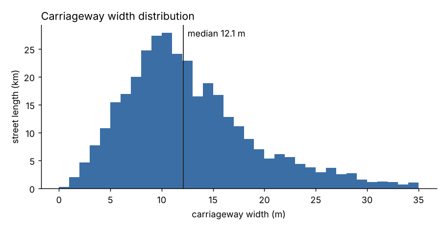
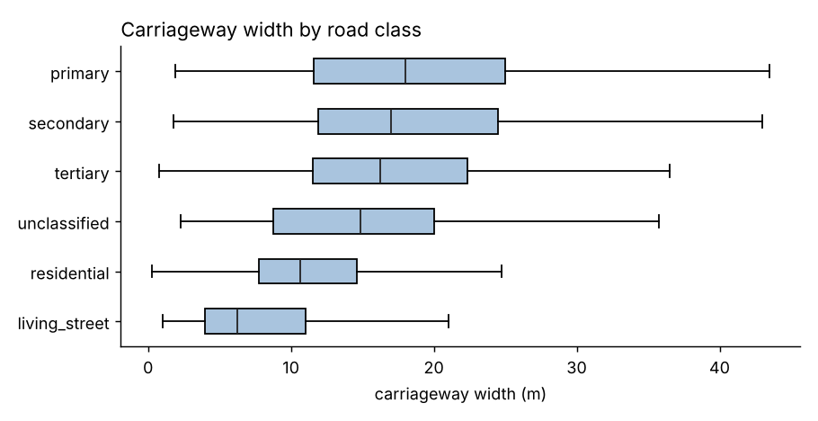
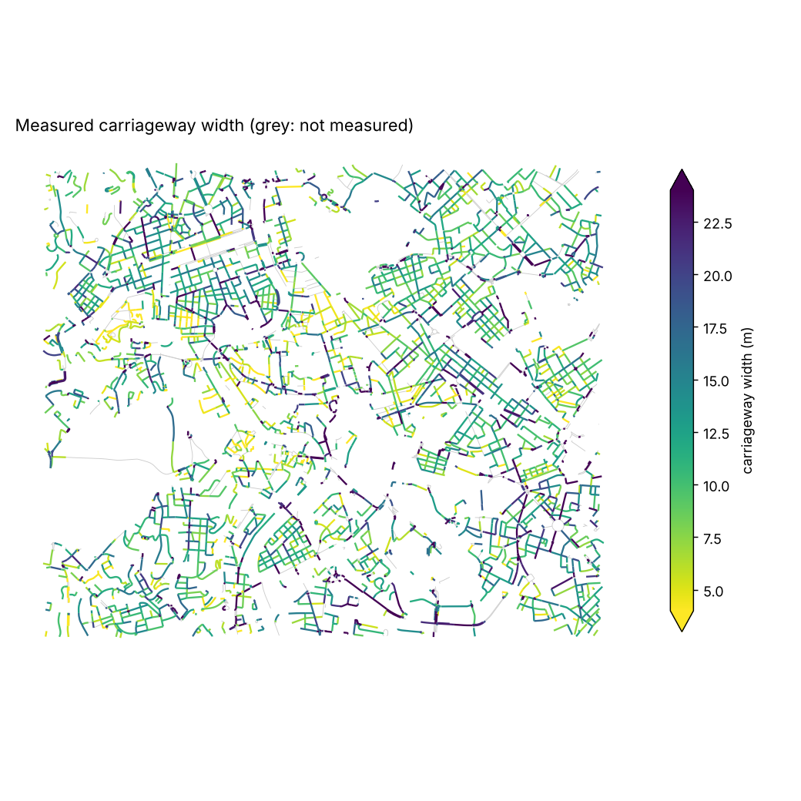

# Road statistics: Roma (centro, ~30 km2)

Area 36.9 km2, bbox [12.44, 41.87, 12.52, 41.92]. Imagery: Esri World Imagery Wayback 2021-11-30 (Esri, Maxar, Earthstar Geographics) (0.222 m/pixel). Street network: OpenStreetMap contributors (ODbL). Generated 2026-11-12T10:28:28Z.

## Network

- 8188 street segments, 603.5 km, 2248 named streets
- measured on imagery: 88% of the length (57% with good or fair quality)
- not measured: {'open_area': 803, 'too_short': 580, 'canopy': 220, 'not_visible': 147, 'tunnel': 110, 'inconsistent': 4}
- one-way: 74% of the length, dual carriageways: 19%
- paved carriageway area: 8.33 km2 (22.6% of the study area)

## Widths (metres, segments with good or fair quality)

| quantity | n | mean | mean_length_weighted | median | std | p10 | p25 | p75 | p90 |
|---|---|---|---|---|---|---|---|---|---|
| carriageway (kerb to kerb, includes parking rows) | 4902 | 13.69 | 12.73 | 12.12 | 7.44 | 5.5 | 8.38 | 17.59 | 24.49 |
| travel way (carriageway minus parking rows) | 4902 | 9.49 | 8.62 | 7.75 | 6.48 | 3.0 | 4.62 | 12.62 | 19.0 |
| building to building | 2766 | 17.14 | 17.08 | 16.25 | 6.65 | 9.38 | 12.25 | 20.72 | 26.31 |
| parking row | 5008 | 4.11 |  | 3.88 | 1.57 | 2.12 | 2.75 | 5.5 | 6.5 |
| sidewalk (kerb to facade) | 3552 | 3.29 |  | 3.0 | 1.64 | 1.38 | 2.0 | 4.25 | 5.75 |

### Carriageway width by road class

| class | n | mean | mean_length_weighted | median | std | p10 | p25 | p75 | p90 |
|---|---|---|---|---|---|---|---|---|---|
| trunk | 4 | 29.72 | 31.25 | 28.94 | 4.07 | 25.79 | 25.85 | 32.81 | 34.27 |
| primary | 321 | 18.59 | 18.15 | 18.0 | 8.71 | 7.62 | 11.62 | 25.0 | 30.12 |
| secondary | 492 | 18.31 | 17.3 | 17.0 | 8.39 | 8.38 | 11.94 | 24.5 | 28.99 |
| tertiary | 799 | 17.26 | 16.01 | 16.25 | 7.75 | 7.75 | 11.5 | 22.38 | 28.55 |
| unclassified | 81 | 15.61 | 14.26 | 14.88 | 8.49 | 5.75 | 8.75 | 20.0 | 27.5 |
| residential | 3114 | 11.61 | 10.97 | 10.62 | 5.92 | 5.0 | 7.75 | 14.62 | 19.5 |
| living_street | 91 | 8.7 | 7.84 | 6.25 | 6.44 | 3.0 | 4.0 | 11.0 | 19.5 |

### Carriageway width by OSM lane count

| lanes | n | mean | mean_length_weighted | median | std | p10 | p25 | p75 | p90 |
|---|---|---|---|---|---|---|---|---|---|
| 1 | 2329 | 11.73 | 10.94 | 10.5 | 6.16 | 5.25 | 7.75 | 14.38 | 20.05 |
| 2 | 1592 | 16.24 | 15.32 | 15.5 | 7.28 | 7.75 | 11.12 | 20.25 | 26.48 |
| 3 | 155 | 19.1 | 17.85 | 18.25 | 8.17 | 9.55 | 13.06 | 24.25 | 31.3 |
| 4 | 197 | 22.13 | 21.79 | 22.25 | 7.34 | 11.97 | 18.0 | 26.5 | 31.5 |
| 5 | 7 | 26.68 | 25.07 | 25.75 | 5.47 | 20.85 | 23.38 | 29.19 | 33.67 |
| 6 | 10 | 28.09 | 28.37 | 29.93 | 10.21 | 15.15 | 24.81 | 36.75 | 38.27 |

### Carriageway width by direction

| direction | n | mean | mean_length_weighted | median | std | p10 | p25 | p75 | p90 |
|---|---|---|---|---|---|---|---|---|---|
| one_way | 3687 | 13.37 | 12.32 | 11.75 | 7.25 | 5.5 | 8.25 | 17.0 | 24.0 |
| two_way | 1215 | 14.67 | 13.98 | 14.0 | 7.9 | 5.25 | 8.75 | 19.25 | 25.45 |

## Parking and sidewalks

- share of street length with parking rows on 0 / 1 / 2 sides: {'0': 0.273, '1': 0.424, '2': 0.303}
- kerb length with parking: 352.8 km; mean occupancy of detected rows: 0.66
- row type (share of kerb sides): {'none': 0.489, 'perpendicular': 0.188, 'parallel': 0.177, 'diagonal': 0.146}
- share of street length with a measurable sidewalk on 0 / 1 / 2 sides: {'0': 0.397, '1': 0.431, '2': 0.172}

## Speed limits, lanes (from OSM)

- speed limit share of length (km/h): {'15': 0.0, '20': 0.013, '30': 0.082, '40': 0.006, '50': 0.899}
- speed limit source: {'default': 0.42, 'osm': 0.58}
- lanes share of length: {'1': 0.492, '2': 0.412, '3': 0.045, '4': 0.046, '5': 0.002, '6': 0.002}

## Agreement with OSM tags

- lanes: {'n': 4290, 'exact': 0.42, 'within_1': 0.733, 'mean_diff': 0.87}
- width_tag: {'n': 49, 'mae_m': 4.45, 'bias_m': 3.12, 'median_abs_m': 3.5}
- parking_presence: {'n_sides': 626, 'agreement': 0.634, 'osm_yes_detected': 0.629, 'osm_no_detected': 0.333}
- sidewalk_sides: {'n': 1552, 'exact': 0.303}

## Intersections

- 3786 intersections (102.6 per km2, 6.27 per km of road), 21 roundabouts, 540 with traffic signals
- by number of arms: {'1': 72, '2': 69, '3': 2313, '4': 1062, '5': 149, '6': 83, '7': 18, '8': 11, '9': 1, '10': 3, '11': 1, '12': 2, '13': 1, '15': 1}
- approximate diameter (m): {'n': 3697, 'mean': 15.47, 'median': 13.4, 'std': 9.25, 'min': 1.0, 'p10': 7.6, 'p25': 10.0, 'p75': 18.8, 'p90': 25.24, 'max': 172.9}

## Widest and narrowest streets (median carriageway, at least 200 m measured)

| widest | m | narrowest | m |
|---|---|---|---|
| Viale Castro Pretorio | 33.2 | Borgo Vittorio | 3.1 |
| Via Giuseppe Ferrari | 31.1 | Via dei Campani | 3.2 |
| Via Luisa di Savoia | 31.0 | Via Belsiana | 3.8 |
| Via della Giuliana | 30.4 | Viale dei Colli Portuensi | 3.8 |
| Via del Teatro di Marcello | 29.9 | Via Mario de' Fiori | 3.8 |
| Viale Marco Polo | 29.8 | Via del Pellegrino | 4.0 |
| Via Albalonga | 28.8 | Via della Vite | 4.0 |
| Via Aosta | 28.0 | Via del Governo Vecchio | 4.1 |
| Piazzale Ostiense | 27.4 | Via Alberto Cadlolo | 4.2 |
| Via Statilia | 27.0 | Via Pietro Campora | 4.2 |

